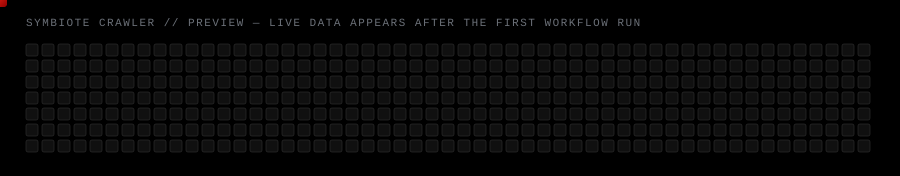

<!--
  SYMBIOTEX — GitHub profile README for SymbioteX01
  This repository MUST be named exactly: SymbioteX01   (public, with this README.md at the root)
  Pending items (LinkedIn, email, repo links, stacks, log entries) are filled by:
      1) editing profile.config.json   2) running: python scripts/configure.py
  See docs/CUSTOMIZATION.md and docs/DEPLOYMENT.md
-->

<a href="#symbiote-dossier"><code>DOSSIER</code></a>&nbsp;&nbsp;
<a href="#technical-arsenal"><code>ARSENAL</code></a>&nbsp;&nbsp;
<a href="#classified-project-files"><code>PROJECT FILES</code></a>&nbsp;&nbsp;
<a href="#symbiote-telemetry"><code>TELEMETRY</code></a>&nbsp;&nbsp;
<a href="#clearance-log"><code>CLEARANCE LOG</code></a>&nbsp;&nbsp;
<a href="#establish-connection"><code>CONNECT</code></a>

  

I'm <b>Ayush Amol Navale</b>, an Information Technology student at MIT Academy of Engineering, Pune. 
I'm interested in how AI can make everyday systems — campuses, networks, canteens, health tools — a little smarter, 
and I build projects to find out what works. <b>Explore. Experiment. Build. Evolve.</b>

<h2 align="center">SYMBIOTE DOSSIER</h2>

 

**AI and software journey.** My toolkit covers core programming (Python, C, C++, JavaScript), web front-end (HTML, CSS, React),
data and AI libraries (TensorFlow, NumPy, Pandas, Matplotlib), databases, and analytics tools. My projects point that toolkit at problems
I actually run into: finding clubs on campus, diagnosing slow Wi-Fi, keeping canteens hygienic, and making glucose management easier to reason about.

**Current learning direction**

- Applied AI and machine learning
- Intelligent tools for networks and health technology
- Turning project ideas into complete, usable software

<h2 align="center">TECHNICAL ARSENAL</h2>

What I work with. I don't rate myself on a scale — I'm a student, and the whole point is to keep evolving.
  
<table>

<tr><td align="right" width="150"><code>PROGRAMMING</code></td><td>   </td></tr>
<tr><td align="right" width="150"><code>FRONTEND</code></td><td>  </td></tr>
<tr><td align="right" width="150"><code>AI &amp; DATA</code></td><td>   </td></tr>
<tr><td align="right" width="150"><code>DATABASES</code></td><td> </td></tr>
<tr><td align="right" width="150"><code>TOOLS</code></td><td>     </td></tr>
</table>

<h2 align="center">CLASSIFIED PROJECT FILES</h2>

Repository links and stacks are shown only once I've confirmed them. Nothing here is padded.

A centralized campus platform for club discovery, event management, and student memberships. Initially designed for MITAOE, with an architecture intended to support multiple colleges. 
<!--@P1_STACK--><code>STACK ▸ [ PENDING CONFIRMATION ]</code><!--/@P1_STACK--> 
<!--@P1_REPO--><code>REPOSITORY ▸ [ LINK PENDING ]</code><!--/@P1_REPO--> <!--@P1_STATUS--><code>STATUS ▸ IN DEVELOPMENT</code><!--/@P1_STATUS-->

An AI-assisted network analysis project focused on network traffic analysis, anomaly detection, and network troubleshooting. 
<!--@P2_STACK--><code>STACK ▸ [ PENDING CONFIRMATION ]</code><!--/@P2_STACK--> 
<!--@P2_REPO--><code>REPOSITORY ▸ [ LINK PENDING ]</code><!--/@P2_REPO--> <!--@P2_STATUS--><code>STATUS ▸ IN DEVELOPMENT</code><!--/@P2_STATUS-->

An intelligent network diagnostics concept designed to identify Wi-Fi problems, explain root causes, and suggest fixes. 
<!--@P3_STACK--><code>STACK ▸ [ PENDING CONFIRMATION ]</code><!--/@P3_STACK--> 
<!--@P3_REPO--><code>REPOSITORY ▸ [ LINK PENDING ]</code><!--/@P3_REPO--> <!--@P3_STATUS--><code>STATUS ▸ IN DEVELOPMENT</code><!--/@P3_STATUS-->

An AI-assisted hypoglycemia prediction and Indian food carbohydrate-counting project. A learning and research project, not medical advice. 
<!--@P4_STACK--><code>STACK ▸ [ PENDING CONFIRMATION ]</code><!--/@P4_STACK--> 
<!--@P4_REPO--><code>REPOSITORY ▸ [ LINK PENDING ]</code><!--/@P4_REPO--> <!--@P4_STATUS--><code>STATUS ▸ PROTOTYPE / IN DEVELOPMENT</code><!--/@P4_STATUS-->

A canteen hygiene and food safety management application. 
<!--@P5_STACK--><code>STACK ▸ [ PENDING CONFIRMATION ]</code><!--/@P5_STACK--> 
<!--@P5_REPO--><code>REPOSITORY ▸ [ LINK PENDING ]</code><!--/@P5_REPO--> <!--@P5_STATUS--><code>STATUS ▸ PROTOTYPE</code><!--/@P5_STATUS-->

<h2 align="center">SYMBIOTE TELEMETRY</h2>

<table>
<tr>
<td></td>
<td></td>
</tr>
</table>

 

 

Live cards come from third-party services (github-readme-stats, streak-stats, github-readme-activity-graph) and can be slow or rate-limited;
if one is blank, open <a href="https://github.com/SymbioteX01">the profile</a> for the source data. The crawler is generated by a GitHub Action in this repository.

<h2 align="center">CLEARANCE LOG</h2>

Verified entries only. Anything unconfirmed stays marked as pending.

<table>
<tr><td align="right"><code>CERTIFICATIONS</code></td><td><!--@A_CERT-->Cisco Networking Academy — JavaScript Essentials 1 Cisco Networking Academy — JavaScript Essentials 2<!--/@A_CERT--></td></tr>
<tr><td align="right"><code>TECHNICAL LEARNING</code></td><td><!--@A_LEARN-->B.Tech in Information Technology — MIT Academy of Engineering, Pune<!--/@A_LEARN--></td></tr>
<tr><td align="right"><code>INTERNSHIP</code></td><td><!--@A_INTERN-->Cisco AICTE Virtual Internship Program 2026 — Artificial Intelligence (June–August 2026)<!--/@A_INTERN--></td></tr>
<tr><td align="right"><code>PROJECT MILESTONES</code></td><td><!--@A_MILE--><code>[ AWAITING VERIFIED ENTRY ]</code><!--/@A_MILE--></td></tr>
<tr><td align="right"><code>HACKATHONS</code></td><td><!--@A_HACK--><code>[ AWAITING VERIFIED ENTRY ]</code><!--/@A_HACK--></td></tr>
</table>

<h2 align="center">ESTABLISH CONNECTION</h2>

<!--@LINKEDIN--><!--/@LINKEDIN-->
<!--@EMAIL--><!--/@EMAIL-->

